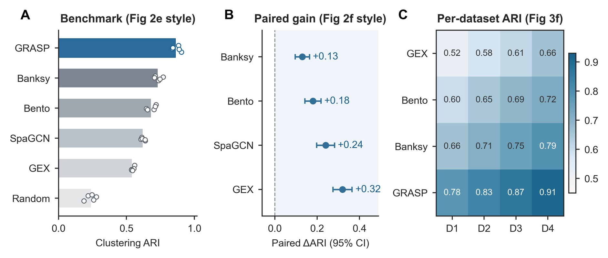
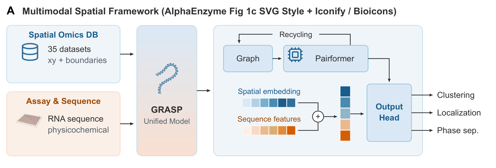
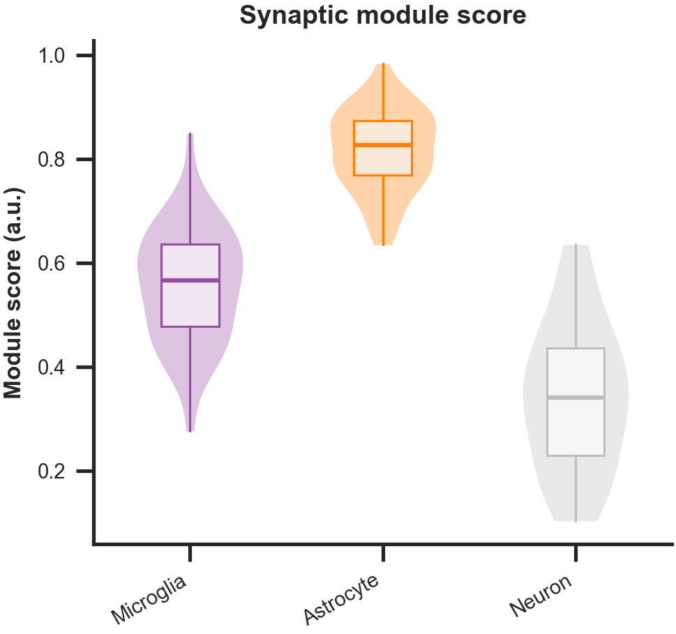
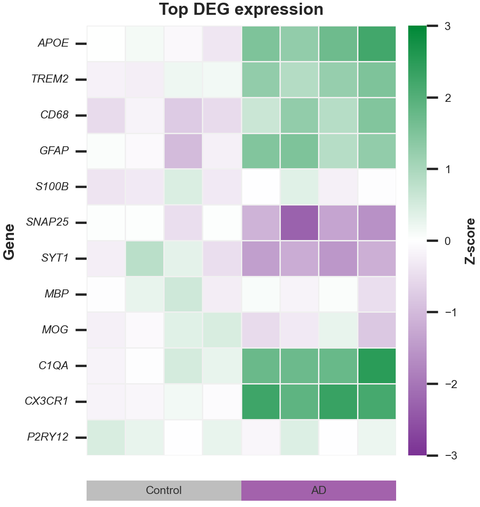

# bioinformatics-plotting-standards

面向 **生物信息学与计算方法学单图、简单多 panel（2–4）与 SVG 科研示意图素材** 的出版与学位论文级绘图 Agent Skill，适用于 Cursor、Claude Code、Codex 等支持 `SKILL.md` 的 Agent 环境。

涵盖常规生信图（火山图、热图、UMAP/t-SNE、violin、dotplot、spatial、Manhattan）以及 **19 类高信息密度进阶图型**（云雨图、配对哑铃图、山脊图、排序棒棒糖图、异构混合相关矩阵、Funkyheatmap、UpSet、桑基冲积图、SHAP 蜂群图，以及 *AlphaEnzyme* 风格的热图+箱线+胜率三联图、配对差值森林图、四象限 OOD 分层图、瀑布图+内嵌表等）。

---

## 效果示例

由本仓库自带样式模块（`thesis_style.py`、`alphaenzyme_colors.py`、`violin_boxplot.py`、`heatmap_annotation.py`、`fetch_icon.py`）直接生成：

| AlphaEnzyme 风格方法学三联图（扁平 `7.5 pt` + 大写 `10 pt` A/B/C） | AlphaEnzyme Fig 1c 风格 SVG 架构图（Iconify + Bioicons 矢量内联） |
|:---:|:---:|
|  |  |
| 小提琴 + 箱线叠画（Li Lab `triple`） | 发散热图（Nature AD2024 紫–绿 + 独立列分组色条） |
|  |  |

---

## 核心特性

1. **19 类高表现力图型智能选型**（`references/chart-selection.md`）
   - 融合 [From Data to Viz](https://www.data-to-viz.com/) 数据形态决策树与 *Nature Methods* / *AlphaEnzyme* 实战范式；当用户未锁死基础图型时，主动匹配信息密度更高的可视化，告别一味画普通箱线图和色块热图。
2. **多套出版级即用色板（Python 模块化封装）**
   - **`scripts/alphaenzyme_colors.py`**：80% 钢青蓝 + 15% 暖杏沙 + 5% 焦糖橙法则，内置 Fig 2c/2d（4–5 方法柱/箱/小提琴）、Fig 2e（全冷灰阶梯 + 唯一主角钢蓝）、Fig 3f 单向钢青蓝热图色带；
   - **`scripts/nature_ad2024_colors.py`**：Nature AD2024 紫–绿发散热图、顺序紫、含棕色系的 11 色 UMAP 定性板；
   - **`scripts/violin_boxplot.py`** & **`NMI Pastel`**：Li Lab `pair`/`triple` 叠画配色与低饱和方法族色板。
3. **三档排版与导出策略 + 自动质检**（`references/export-policy.md`、`references/thesis-format.md`）
   - **`thesis`（近期默认 · 学位论文规范）**：宽度随内容自由设定且建议 $\le 6.20\text{ in}$（`15.75 cm` 适配 A4 竖排净版心免缩放），扁平 `7.5 pt` 统一正文/轴/刻度/图例字号（严守 $\le 10.5\text{ pt}$ 五号字红线），大写 `10.0 pt Arial Bold` `A/B/C/D` 面板字母，斜体统计符号（*p*、*n*、*r*），`mol/L` 单位与多曲线不同 Marker；
   - **`publication`（英文 SCI 期刊投稿）**：600 DPI PNG + 可编辑 PDF + SVG；
   - **`communication`（组会日常沟通）**：300 DPI PNG + SVG；
   - **`scripts/qc.py`**：支持 `--mode thesis|publication|communication`，用 PyMuPDF 直接校验 PDF 物理字号上限、面板字母大小写与字体一致性、浓度单位及 DPI。
4. **SVG 模型/流程示意图风格 + 通用/生物图标一键内联**（`references/svg-schematic-style.md`、`scripts/fetch_icon.py`）
   - 沉淀 *AlphaEnzyme* **Fig 1c（双模态冰蓝/暖杏柔和底块 + 1D 渐变张量条）** 与 **Fig 2b（纯白细黑框清洗流程 + 全灰单点钴蓝队列图）** 精确 SVG Token；
   - 内置 `fetch_icon.py` 一键对接 **Iconify（Lucide / Phosphor / Heroicons / Tabler）** 与 **Bioicons（2,829 个生医 SVG，含 1,375 个 Servier Medical Art 与 634 个 DBCLS）**，自动清洗命名空间、改色、本地缓存并输出 `<g>` 内联片段。

---

## 与兄弟 Skill 的生态分工

| 任务需求 | 推荐工具 / Skill | 说明 |
|------|------|------|
| 单张生信数据图、简单 2–4 panel 组合 | **本 Skill** | Python（默认）/ R 双后端，含 19 类图型选型与 `qc.py` |
| 复杂投稿多面板大组图、Hero Panel、对齐与碰撞审计 | [`nature-figure`](https://github.com/Yuan1z0825/nature-skills/tree/main/skills/nature-figure) | 完整 Figure Contract、1.5 pt 轴框对齐门、PDF 碰撞检测 |
| **可编辑矢量模型架构图 / 方法总览图 / 数据清洗流程图（SVG/PDF/PPTX）** | [**`FigGenie-paper-diagram-skill`**](https://github.com/Sleepy-Avacado/FigGenie-paper-diagram-skill) + 本 Skill `svg-schematic-style.md` & `fetch_icon.py` | **强烈推荐组合**：`FigGenie` 负责 3,600+ 顶会布局范例、真实字宽测量、无头浏览器几何 Lint 与原生 PPTX 导出；本 Skill 提供 AlphaEnzyme 视觉规范与 Lucide/Bioicons 图标库 |
| 强艺术化生物机制插画 / 概念图形摘要灵感 | Agent 的 **GenerateImage** | 适合立体细胞/器官草图或概念海报，不用于定量数据图 |
| 论文润色、统计审查、DA statement、PPT | [`nature-skills`](https://github.com/Yuan1z0825/nature-skills) 对应模块 | 写作与投稿辅助 |

---

## SVG 示意图与科研图标工作流

绘制论文方法图、模型架构图或数据集筛选流程图时，推荐 **「`FigGenie` 布局与质检 + 本仓库 AlphaEnzyme SVG 规范 + `fetch_icon.py` 图标库」** 联动：

### 1. 搭配 `FigGenie` 获得顶会级矢量 SVG / PDF / 可编辑 PPTX
- 安装 [`Sleepy-Avacado/FigGenie-paper-diagram-skill`](https://github.com/Sleepy-Avacado/FigGenie-paper-diagram-skill) 后，在画图提示词中点名套用本仓库的 `references/svg-schematic-style.md`：
  - **Fig 1c 风格**：双模态柔和无黑框底色卡（冰蓝 `#F0F5FB` / 暖杏 `#FCF0E9`）+ 1D 渐变张量条 + `#303030` 炭灰线；
  - **Fig 2b 风格**：纯白细黑框清洗流程 + 下方全灰单点钴蓝 `#2066AC` 队列统计缩略图。
- `FigGenie` 会自动完成真实字形测量、无头 Chromium 几何防碰撞 Lint、字体子集内嵌（SVG/PDF）以及可编辑 `.pptx` 导出。

### 2. 用 `scripts/fetch_icon.py` 一行命令拉取通用 & 生物矢量图标
避免从零手搓粗糙图标，也禁止在 SVG 里用 `<image href="https://...">` 外链。脚本免鉴权、自动缓存至 `~/.cache/bio-plot-icons/`、自动给 `id` 和 `.cls-*` CSS 类加唯一前缀防样式串扰：

```bash
# 1) 混合检索通用图标（Lucide/Phosphor/Heroicons/Tabler）与生物图标（Bioicons/Servier/DBCLS）
python scripts/fetch_icon.py search "database" --limit 6
python scripts/fetch_icon.py search "microscope" --limit 6
python scripts/fetch_icon.py search "rna" --source bioicons --limit 8

# 2) 下载并改色为独立干净 SVG（Bioicons 不传 --color 则保留原色）
python scripts/fetch_icon.py fetch lucide:database --color "#316F98" --stroke-width 1.6 -o icon_db.svg
python scripts/fetch_icon.py fetch bioicons:dna-2 --color "#316F98" -o icon_dna.svg
python scripts/fetch_icon.py fetch bioicons:96_well_plate_cells -o icon_plate.svg

# 3) 直接生成可嵌进主图的内联 <g> 片段（等比缩放居中至 (x, y) 的 size×size pt 盒内）
python scripts/fetch_icon.py fetch lucide:filter --inline-g --x 12 --y 24 --size 14 --color "#303030"
```

在 Python 生成 SVG 脚本中直接内联调用：

```python
from scripts.fetch_icon import inline_icon_g

g_db    = inline_icon_g("lucide:database", x=18, y=38, size=18, color="#316F98", stroke_width=1.6)
g_plate = inline_icon_g("bioicons:96_well_plate_cells", x=14, y=97, size=24)  # 保留原色
g_dna   = inline_icon_g("bioicons:dna-2", x=136, y=57, size=28, color="#316F98")
```

> **风格与许可提示**：同一张图的工程逻辑图标建议统一选用 **`lucide:`**（细线圆角）；`lucide` / `heroicons` / `ph` / `tabler` 与 Bioicons `CC-0` 图标免费免署名，Bioicons 中的 `CC-BY`（含 Servier Medical Art 与 DBCLS）会在运行脚本时自动提示署名。

---

## 安装与依赖

### 安装 Skill（Cursor / Claude Code / Codex）

```bash
git clone https://github.com/Rooneyxu/bioinformatics-plotting-standards.git
# 任选其一（或软链至 ~/.claude/skills/）
cp -R bioinformatics-plotting-standards ~/.agents/skills/
cp -R bioinformatics-plotting-standards ~/.cursor/skills/
```

重启 Agent 或新开对话即可生效。可选在 User Rule 中补充一句以提高触发稳定性：

```text
涉及到生信相关的画图任务，使用 bioinformatics-plotting-standards skill。
```

### Python / R 依赖

```bash
pip install matplotlib seaborn pillow pandas numpy pymupdf lxml adjustText
# 仅在使用 R 后端时需要 R + ggplot2 / patchwork / ComplexHeatmap / ggrepel 等
```

---

## 目录结构

```text
bioinformatics-plotting-standards/
├── SKILL.md                     # Agent 主规范（含触发描述、19 类图型选型门与三档排版路由）
├── references/                  # 模块化参考文档
│   ├── thesis-format.md         # 学位论文扁平 7.5pt 统一字号、大写 A/B/C/D 与细节规范
│   ├── chart-selection.md       # 19 类进阶生信与方法学图型选型指南（含 AlphaEnzyme 6 类实战组合图）
│   ├── svg-schematic-style.md   # SVG 模型/流程示意图规范（AlphaEnzyme Fig 1c/2b）与图标库用法
│   ├── color_schemes.md         # AlphaEnzyme 钢蓝–暖杏 / Nature AD2024 / Li Lab / NMI Pastel 色板
│   ├── export-policy.md         # thesis / publication / communication 三档导出策略
│   ├── when-to-plot.md          # 何时出图、与 nature-figure / FigGenie / GenerateImage 边界
│   ├── backend-selection.md     # Python / R 门禁与互斥规则
│   ├── violin-boxplot.md        # Li Lab 小提琴+箱线叠画
│   ├── heatmap-annotation.md    # 热图独立轴列分组注释
│   ├── journal_requirements.md  # Nature / Cell / Science 期刊尺寸与字体
│   └── troubleshooting.md       # 标签重叠、截断、colorbar 等排错
├── scripts/
│   ├── thesis_style.py          # 学位论文扁平 7.5pt 样式、大写面板字母与斜体 p 辅助模块
│   ├── alphaenzyme_colors.py    # AlphaEnzyme 钢蓝–暖杏色板（80/15/5 & Fig 2c/2d/2e）
│   ├── fetch_icon.py            # Iconify & Bioicons (含 Servier) SVG 检索/清洗/改色/内联工具
│   ├── qc.py                    # 出图后 DPI / 格式 / PDF 字号(<=10.5pt) / 面板字母一致性检查
│   ├── violin_boxplot.py        # Li Lab 小提琴+箱线
│   ├── heatmap_annotation.py    # 热图独立轴列分组注释
│   └── nature_ad2024_colors.py  # Nature AD2024 紫–绿发散与含棕 UMAP 定性色
├── examples/                    # README 展示样图（PNG）
└── evals/                       # skill-creator 行为与触发测试集
    ├── evals.json
    ├── trigger_eval.json
    └── grade_all_evals.py
```

---

## 快速使用示例

直接对 Agent 说：

```text
# 1) 开放式进阶选型 + AlphaEnzyme 配色（自动匹配高信息密度图型）
我有 6 个方法在 12 个空间转录组数据集上的 ARI 结果 CSV，帮我设计一张不单调的基准对比图，用 AlphaEnzyme Fig 2e/2f 配色，按毕业论文规范导出。
```

```text
# 2) 热图 + 共享纵轴箱线 + Top-3 胜率三联图
把各方法在 8 个留一法折上的 Spearman 相关画成 AlphaEnzyme Fig 3f 风格的「热图+侧边箱线+胜率条」三联图，跑 thesis QC。
```

```text
# 3) DESeq2 火山图（组会快速预览，走 communication 档）
用 Python 画 DESeq2 火山图，padj<0.05 标 top15 基因，组会预览 SVG + 300 DPI PNG 即可。
```

```text
# 4) 英文 SCI 投稿图（自动切回 publication 档并确认 Python/R 后端）
画 scanpy UMAP + marker dotplot 准备投 Nature Methods，用 Nature AD2024 含棕定性配色，600 DPI 导出。
```

```text
# 5) SVG 模型架构图 / 数据筛选图（联动 FigGenie + fetch_icon.py）
参考 svg-schematic-style.md 的 AlphaEnzyme Fig 1c 风格，用 figgenie-paper-diagram 画一张多模态空间模型架构图，数据库和细胞/RNA 图标通过 fetch_icon.py 从 Lucide 和 Bioicons 拉取内联。
```

出图后运行自动质检：

```bash
# 学位论文规范（近期默认：检查 600 DPI、PDF 字号 <= 10.5pt、大写 A/B/C/D 一致性、mol/L 单位）
python scripts/qc.py your_figure.png --mode thesis
# 英文 SCI 期刊投稿场景
python scripts/qc.py your_figure.png --mode publication
# 日常组会沟通场景
python scripts/qc.py your_figure.png --mode communication
```

---

## 来源与致谢

本 Skill 在多份优秀开源规范与学术可视化实践的基础上整合、定制与二次开发而成，特别感谢以下项目：

| 来源 | 借鉴与联动内容 |
|------|------|
| [**Yuan1z0825/nature-skills**](https://github.com/Yuan1z0825/nature-skills) | `nature-figure` 绘图规范（字体、NMI Pastel、导出、多面板信息架构），复杂投稿大组图仍直接路由至该 Skill |
| [**Sleepy-Avacado/FigGenie-paper-diagram-skill**](https://github.com/Sleepy-Avacado/FigGenie-paper-diagram-skill) | 顶会风格可编辑矢量 SVG/PDF/PPTX 架构图与无头浏览器 Lint 工作流，推荐与本 Skill 的 SVG 规范及图标工具联合使用 |
| **biomni** 生信 Agent 绘图规范 | 何时出图、Python/R 互斥栈、色盲友好与分层导出工作流 |
| [**From Data to Viz**](https://www.data-to-viz.com/) | 数据形态选图决策树与常见可视化避坑规范（`chart-selection.md`） |
| [**AlphaEnzyme** (Liu et al., bioRxiv 2026)](https://www.biorxiv.org/content/10.64898/2026.11.04.764416v2) | 80/15/5 钢蓝–暖杏色板、Fig 2c/2d/2e 基准对比配色、6 类高阶方法学组合图及 Fig 1c/2b SVG 风格 |
| [**Iconify**](https://iconify.design/) & [**Bioicons**](https://bioicons.com/) | `scripts/fetch_icon.py` 对接的免鉴权通用（Lucide / Phosphor / Heroicons / Tabler）与生命科学（含 Servier Medical Art / DBCLS）开源矢量图标源 |

---

## 许可证

MIT License — 见 [LICENSE](LICENSE)。

使用本 Skill 及其辅助脚本时，请同时遵守 [nature-skills](https://github.com/Yuan1z0825/nature-skills) 与对应第三方图标库（特别是 Bioicons 中的 `CC-BY` / Servier Medical Art 图标）的署名规范。

---

## 联系

- GitHub: [@Rooneyxu](https://github.com/Rooneyxu)
- Email: 1910305118@pku.edu.cn
